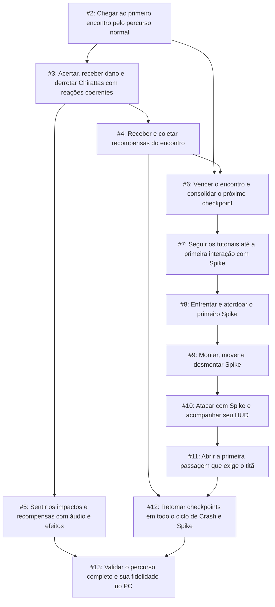

# Primeiro encontro completo e primeira passagem com Spike

Planejamento aprovado em 21/10/2026. Configuração das skills: GitHub Issues, cinco labels padrão e documentação single-context em AGENTS.md.

Especificação principal: [#1](https://github.com/Kauerc10/crash-titans-web/issues/1). [Cópia da especificação](first-encounter-and-spike-spec.md).

## Tickets e dependências

Cada ticket é uma entrega verificável. Todos são sub-issues da especificação e usam ready-for-agent; isso não remove seus bloqueios. O GitHub é a fonte de estado atual.

| Ticket | Entrega | Bloqueado por |
| --- | --- | --- |
| [#2](https://github.com/Kauerc10/crash-titans-web/issues/2) | Chegar ao primeiro encontro pelo percurso normal | Nenhum |
| [#3](https://github.com/Kauerc10/crash-titans-web/issues/3) | Acertar, receber dano e derrotar Chirattas com reações coerentes | [#2](https://github.com/Kauerc10/crash-titans-web/issues/2) |
| [#4](https://github.com/Kauerc10/crash-titans-web/issues/4) | Receber e coletar recompensas do encontro | [#3](https://github.com/Kauerc10/crash-titans-web/issues/3) |
| [#5](https://github.com/Kauerc10/crash-titans-web/issues/5) | Sentir os impactos e recompensas com áudio e efeitos | [#3](https://github.com/Kauerc10/crash-titans-web/issues/3) |
| [#6](https://github.com/Kauerc10/crash-titans-web/issues/6) | Vencer o encontro e consolidar o próximo checkpoint | [#2](https://github.com/Kauerc10/crash-titans-web/issues/2), [#4](https://github.com/Kauerc10/crash-titans-web/issues/4) |
| [#7](https://github.com/Kauerc10/crash-titans-web/issues/7) | Seguir os tutoriais até a primeira interação com Spike | [#6](https://github.com/Kauerc10/crash-titans-web/issues/6) |
| [#8](https://github.com/Kauerc10/crash-titans-web/issues/8) | Enfrentar e atordoar o primeiro Spike | [#7](https://github.com/Kauerc10/crash-titans-web/issues/7) |
| [#9](https://github.com/Kauerc10/crash-titans-web/issues/9) | Montar, mover e desmontar Spike | [#8](https://github.com/Kauerc10/crash-titans-web/issues/8) |
| [#10](https://github.com/Kauerc10/crash-titans-web/issues/10) | Atacar com Spike e acompanhar seu HUD | [#9](https://github.com/Kauerc10/crash-titans-web/issues/9) |
| [#11](https://github.com/Kauerc10/crash-titans-web/issues/11) | Abrir a primeira passagem que exige o titã | [#10](https://github.com/Kauerc10/crash-titans-web/issues/10) |
| [#12](https://github.com/Kauerc10/crash-titans-web/issues/12) | Retomar checkpoints em todo o ciclo de Crash e Spike | [#4](https://github.com/Kauerc10/crash-titans-web/issues/4), [#11](https://github.com/Kauerc10/crash-titans-web/issues/11) |
| [#13](https://github.com/Kauerc10/crash-titans-web/issues/13) | Validar o percurso completo e sua fidelidade no PC | [#5](https://github.com/Kauerc10/crash-titans-web/issues/5), [#12](https://github.com/Kauerc10/crash-titans-web/issues/12) |

## Fluxo de execução

## Critério de aceite do pacote

Jogar pelo percurso normal do menu até a primeira passagem obrigatória resolvida com Spike e o próximo estado estável identificado na origem, sem teleporte nem alterações de estado por inspeção. Cobrir morte/retry, pausa e perda de foco; comparar apresentação com o original localmente.

Os testes determinísticos existentes complementam a aplicação real no navegador. Integração, comparação visual e recursos originais permanecem locais; o clone público executa npm ci e npm run test:core. Controle físico exige validação em hardware.

A primeira tarefa disponível na criação deste plano é #2. As demais começam quando todos os seus bloqueadores forem concluídos. Áudio/efeitos podem avançar em paralelo às recompensas depois do combate, sem impor uma dependência artificial entre eles.

## Limites

Este pacote não conclui o episódio 1 inteiro. Não inclui mobile, outros titãs/fases, save persistente de gameplay ou distribuição dos recursos originais. Código existente já funciona parcialmente; os tickets fecham lacunas de fidelidade e progressão, sem tratar sistemas presentes como inexistentes.
